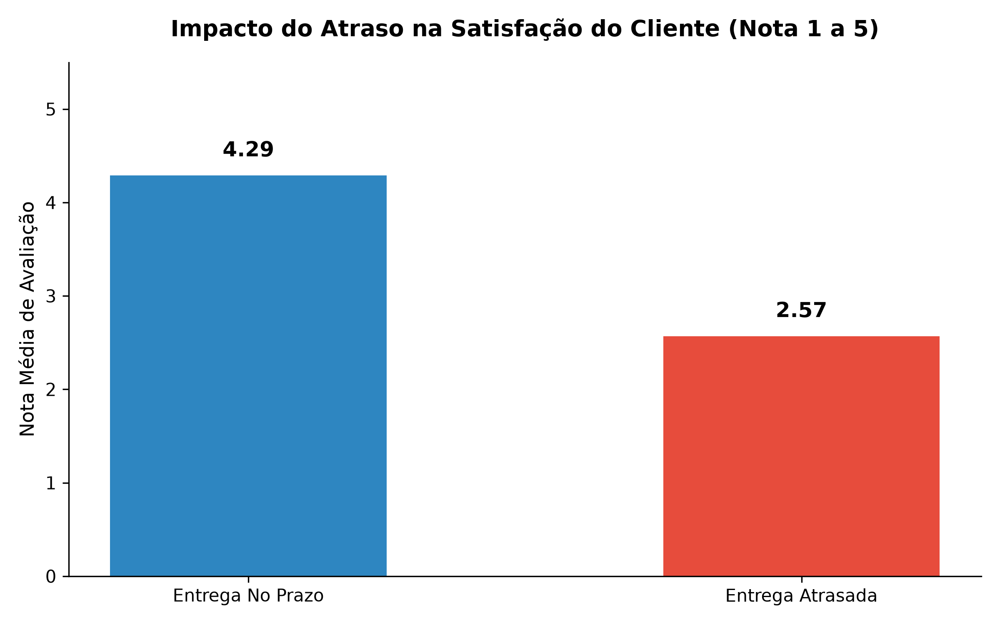

# 📦 Análise de Impacto Logístico no E-commerce Brasileiro (Olist)

Este projeto analisa como os atrasos nas entregas afetam a satisfação dos clientes em um cenário real de e-commerce brasileiro, utilizando **SQL** e **Python**.

## 🎯 Problema de Negócio
Em operações de e-commerce, a experiência pós-compra define a retenção de clientes. O objetivo desta análise foi responder a duas perguntas principais:
1. Qual a proporção de pedidos entregues fora do prazo estimado?
2. Qual o impacto real de um atraso na nota de avaliação (1 a 5 estrelas) dada pelo cliente?

## 🛠️ Tecnologias Utilizadas
* **Python 3** (Pandas, Matplotlib, SQLite3)
* **SQL** (Consultas analíticas, agregações e `JOIN` entre tabelas)

## 📊 Principais Resultados
Ao cruzar quase **100 mil pedidos** com suas respectivas avaliações:
* **Entregas no Prazo (92%):** Nota média de **4,29**.
* **Entregas Atrasadas (8%):** A nota média cai para **2,57** (uma queda de **40%** na satisfação).



## 🚀 Como executar este projeto localmente
1. Clone este repositório:
   ```bash
   git clone https://github.com
   ```
2. Baixe o dataset *Brazilian E-Commerce Public Dataset by Olist* no Kaggle e salve os CSVs dentro de uma pasta chamada `dados/`.
3. Instale as dependências:
   ```bash
   pip install pandas matplotlib
   ```
4. Execute os scripts na ordem:
   ```bash
   python criar_banco.py
   python analise_sql.py
   python gerar_grafico.py
   ```
